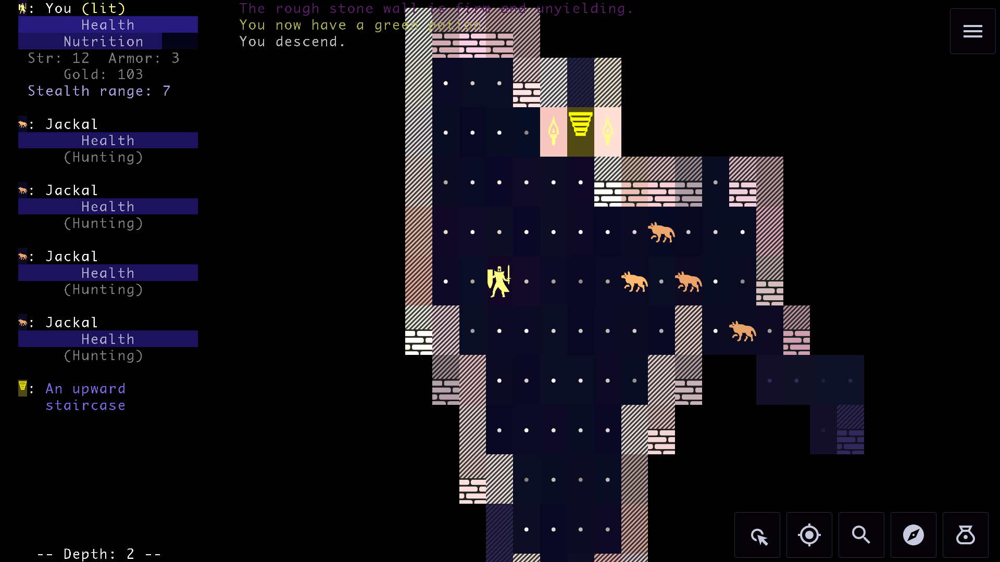

# Brogue PE

Brogue: Phone Edition is an Android port of [Brogue: Community Edition](https://github.com/tmewett/BrogueCE), the community-maintained continuation of the classic dungeon-crawling roguelike Brogue. The port aims to keep the original gameplay while building the controls and menus around touchscreens.

If you run into a bug while playing this port, please report it [here](https://github.com/pineyellow/BroguePE/issues) rather than upstream.

## Highlights

- Configurable D-pad, and swipe controls
- Free-look camera with zoom and pan support
- Personal stats: kills, allies, playtime and more
- Many small UI, layout, interaction, and mobile usability refinements

## Downloads

Download the latest [release](https://github.com/pineyellow/BroguePE/releases/latest).

## Building

See [BUILD.md](BUILD.md) for requirements and build instructions.

## Project lineage and credits
1. **[Brogue](https://sites.google.com/site/broguegame/)**, created by Brian Walker (Pender)
2. **[Brogue: Community Edition](https://github.com/tmewett/BrogueCE)**, maintained by tmewett and the Brogue CE contributors
3. **[Brogue CE Android](https://github.com/tyrannotorus/c-brogue-ce-android)**, ported and adapted for Android by tyrannotorus
4. **Brogue PE**, a modified and remastered version of the Android port

The source retains the original copyright and license notices.

## License

The program is distributed under the [GNU Affero General Public License version 3](LICENSE.txt), with certain source files permitting later versions as stated in their headers.

The bundled tiles have separate attribution and licensing terms under [Creative Commons Attribution-ShareAlike 4.0](bin/assets/LICENSE.txt). Third-party components retain their own licenses.

When distributing an APK or another binary build, make the complete corresponding source for that exact build available under the applicable licenses.
